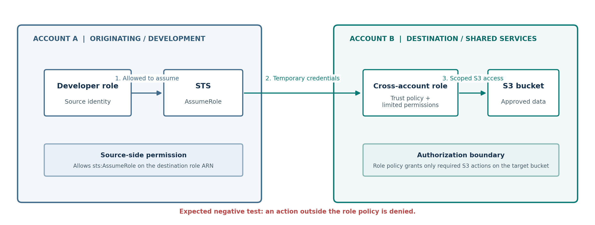
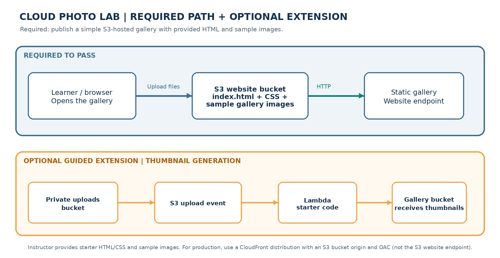
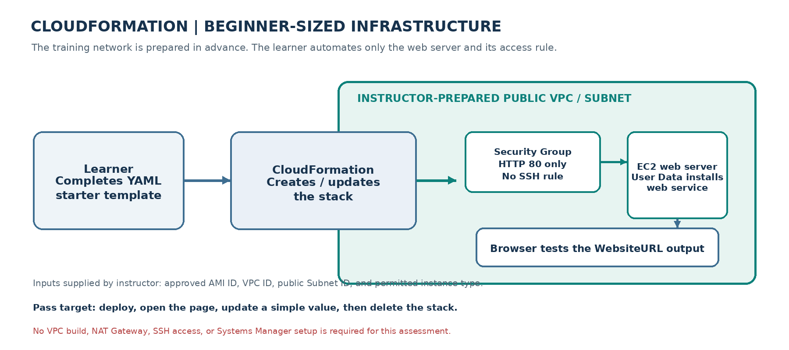

# AWS 2-Week Bootcamp

## Entry-Level Edition

*Build, understand, and automate your first AWS solutions.*

- **01** **SECURE** Cross-account IAM
- **02** **BUILD** S3 static gallery
- **03** **AUTOMATE** CloudFormation

> **PROGRAM FORMAT** 10 working days  \|  8 hours per day  \|  Day 1 reserved for onboarding and Sandbox access  \|  3 major practical activities  \|  Days 9-10 reserved for the final One-Click Infrastructure task and instructor checking.

Designed for learners with little or no prior AWS experience. The bootcamp emphasizes understanding, guided configuration, safe experimentation, and basic troubleshooting. It is not intended to make a beginner production-ready in two weeks.

***CURRICULUM GUIDE  •  INSTRUCTOR AND LEARNER EDITION***

# 1. Program design

## Who this bootcamp is for

Entry-level Cloud Engineers, interns, career shifters, and technical trainees who want a structured introduction to AWS. No prior AWS account administration or cloud project experience is assumed.

## Prerequisites

- Basic computer literacy and the ability to navigate a browser and file system.

- A text editor such as VS Code, or an equivalent editor.

- Basic familiarity with files, folders, and simple command-line instructions is helpful, but AWS CLI usage is introduced during the bootcamp.

- Basic awareness of IP addresses, ports, and web browsers is helpful; networking concepts are taught before they are used.

- Access to the assigned training environments, Sandbox 3 and Sandbox 4. Learners should not use personal production accounts.

## Training environment and schedule

The cohort will use Sandbox 3 and Sandbox 4. Day 1 is a full onboarding and access-setup buffer. For Activity 1, the recommended lab convention is Sandbox 3 as the source account and Sandbox 4 as the destination account; the instructor should confirm this mapping against the access that has been provisioned and reverse it if required. All other exercises must remain within the assigned sandbox permissions and approved Region.

## Learning outcomes

By the end of the program, learners should be able to:

- Navigate the AWS Console and identify the active account, Region, and identity.

- Explain basic AWS infrastructure concepts, shared responsibility, and common cost considerations.

- Describe IAM users, roles, policies, trust relationships, and least-privilege access.

- Use Sandbox 3 and Sandbox 4 for a guided cross-account role-assumption exercise and verify an allowed and denied action.

- Create an S3 bucket, manage sample objects, and publish a basic static website for non-sensitive training content.

- Explain how an S3 event can invoke Lambda to process an uploaded file.

- Explain and configure basic VPC, subnet, route table, Internet Gateway, and Security Group components.

- Launch an EC2 instance and host a simple web page using User Data.

- Find basic metrics and logs in CloudWatch and review account activity in CloudTrail Event history.

- Complete a starter CloudFormation template, deploy a stack, update it, and remove it.

## What entry-level means in this curriculum

> **FOUNDATIONAL EXPECTATION** Learners should be able to follow a guided build, explain the purpose of the main settings, verify the expected result, and troubleshoot common first-level errors. They are not expected to design production architectures or resolve complex production incidents independently.

## Assessment philosophy

Only the three major activities are graded. Daily hands-on exercises are practice, not additional pass/fail submissions. Each major activity is assessed independently; a learner must pass all three. A focused retry is allowed after feedback.

# 2. Two-week schedule at a glance

| **Week** | **Day** | **Topic** | **Expected learning output** |
| --- | --- | --- | --- |
| Week 1 | Day 1 | Onboarding and Sandbox Access Setup | Confirm access to Sandbox 3 and Sandbox 4, verify identity and Region, prepare Console / CloudShell / CLI, and review lab rules. |
| Week 1 | Day 2 | Module 1: AWS Fundamentals | Understand cloud concepts, AWS global infrastructure, accounts, shared responsibility, Console, CLI, and cost basics. |
| Week 1 | Day 3 | Module 2: IAM Fundamentals | Understand identities, roles, policies, trust relationships, STS, and least privilege. |
| Week 1 | Day 4 | Module 3 + Activity 1: Cross-Account IAM | Use Sandbox 3 and Sandbox 4 to configure role assumption and scoped access to an approved S3 bucket. |
| Week 1 | Day 5 | Module 4: S3 and Cloud Storage | Create buckets, manage objects, understand policies, Block Public Access, encryption, versioning, and lifecycle concepts. |
| Week 1 | Day 6 | Module 5 + Activity 2: Static Website and Serverless | Publish a static S3 gallery. Lambda thumbnail generation remains a guided optional extension. |
| Week 2 | Day 7 | Modules 6-7: Networking and Compute | Understand VPCs, CIDR, subnets, routes, Security Groups, EC2, EBS, User Data, and basic managed access. |
| Week 2 | Day 8 | Modules 8-10: Monitoring, Architecture, and CloudFormation | Cover CloudWatch, CloudTrail, SNS, common AWS services, IaC, YAML, and CloudFormation fundamentals before the final task. |
| Week 2 | Day 9 | Activity 3: One-Click Infrastructure - Build | Complete the starter template, provision the Security Group and EC2 web server, and perform the initial deployment. |
| Week 2 | Day 10 | Activity 3: One-Click Infrastructure - Checking | Validate the website, troubleshoot, demonstrate a stack update, complete the technical walkthrough, and clean up. |

## Suggested topic allocation for Days 7 and 8

| **Day** | **Learning modules** | **Approximate allocation within the 8-hour day** |
| --- | --- | --- |
| Day 7 | Module 6: Networking Fundamentals | About 3 hours 15 minutes for concepts, demonstration, and guided network exercises. |
| Day 7 | Module 7: Compute Fundamentals | About 3 hours 30 minutes for EC2 concepts, web server lab, and Session Manager overview. |
| Day 7 | Breaks and lunch | About 1 hour 15 minutes. |
| Day 8 | Module 8: Monitoring and Operations | About 1 hour 30 minutes for CloudWatch, CloudTrail, SNS basics, and troubleshooting. |
| Day 8 | Module 9: AWS Services and Architecture Overview | About 1 hour 15 minutes for service comparison and architecture scenarios. |
| Day 8 | Module 10: IaC and CloudFormation Fundamentals | About 4 hours for YAML, template anatomy, stack lifecycle, and a small guided template exercise. |
| Day 8 | Breaks and lunch | About 1 hour 15 minutes. |

## Suggested daily time allocation

| **Session block** | **Duration** | **Purpose** |
| --- | --- | --- |
| Concepts and discussion | 60 minutes | Introduce the service, vocabulary, use cases, and safety considerations. |
| Instructor demonstration | 60 minutes | Show the workflow and explain the configuration decisions. |
| Guided hands-on lab / activity work | 210 minutes | Learners repeat the steps and complete the guided exercises in their assigned sandbox. |
| Troubleshooting and review | 45 minutes | Work through common errors, validate outputs, and reinforce the key concepts. |
| Breaks and lunch | 75 minutes | Includes the scheduled meal and short breaks. |
| Wrap-up and cleanup | 30 minutes | Check understanding, answer questions, and remove unnecessary resources. |

> **ASSESSMENT AND BUFFER DAYS** Day 1 is reserved for onboarding and Sandbox access setup, not technical instruction. Activity 1 is scheduled for Day 4, Activity 2 for Day 6, and Activity 3 spans both Days 9 and 10 so learners have time to build and instructors have time to check the implementation.

# 3. Week 1 | AWS foundations and identity

Week 1 moves from the AWS environment and basic identity concepts into the first cross-account activity, followed by object storage and a simple static website.

## Day 1  |  Onboarding and Sandbox Access Setup

**Purpose  **Use this full-day buffer to complete access setup, orient learners, and verify that the training environments are ready before technical labs begin.

### Onboarding topics

- Welcome, bootcamp objectives, two-week schedule, expected participation, and communication channels.

- Sandbox 3 and Sandbox 4 access: sign-in method, account identifiers, assigned permissions, and support contact.

- Confirm which sandbox is the source and which is the destination for the cross-account exercise. Recommended mapping: Sandbox 3 = source; Sandbox 4 = destination, unless the sandbox administrator has provisioned the reverse.

- AWS Console navigation, active account, selected Region, and identity verification.

- AWS CloudShell and AWS CLI readiness. Use the approved authentication method; do not create or share long-term access keys.

- Run `aws sts get-caller-identity` in each available sandbox and record the returned account and identity details.

- Confirm learners can access the services needed for the labs, subject to sandbox permissions: IAM, S3, CloudFormation, EC2, and CloudWatch.

- Review sandbox rules, resource restrictions, cost awareness, cleanup expectations, and escalation process.

### Setup validation

**1. **Sign in to Sandbox 3 and verify the account ID and Region.

**2. **Sign in to Sandbox 4 and verify the account ID and Region.

**3. **Open CloudShell or confirm the approved CLI setup in each environment.

**4. **Run the identity check and capture the account and ARN details.

**5. **Confirm the instructor has provided the starter files and the required permissions are available.

**6. **Record access issues and resolve them before Day 2.

**Expected output  **Learner can access both assigned sandboxes, identify each account and Region, verify the active identity, locate the training files, and knows how to request help.

> **DAY 1 IS A BUFFER** Do not schedule a graded practical activity or depend on Day 1 for core AWS instruction. Use the day to resolve account access, permission, workstation, or CLI setup issues.

## Day 2  |  Module 1 | AWS Fundamentals

**FOCUS  ***Cloud concepts, AWS global infrastructure, accounts, Console, CLI, and cost awareness*

**Learning objectives  **Navigate the AWS environment, identify the current account and Region, and run a basic command that confirms the active identity.

### Core topics

- Introduction to cloud computing and common AWS use cases.

- Cloud service models: IaaS, PaaS, and SaaS at a beginner level.

- AWS global infrastructure: Regions, Availability Zones, and Edge Locations.

- AWS accounts, account boundaries, and basic resource organization.

- AWS Shared Responsibility Model.

- AWS Management Console, AWS CloudShell, and AWS CLI: purpose and basic navigation.

- AWS pricing fundamentals, budgets, tags, and resource cleanup.

### Guided practice

**1. **Sign in to the assigned sandbox and locate the account and Region shown in the Console.

**2. **Open AWS CloudShell and run `aws sts get-caller-identity`.

**3. **Identify the account ID and ARN in the command output.

**4. **Change the Console Region and observe that resource views are Region-specific.

**5. **Review where the account budget or cost monitoring information is displayed.

**Expected output  **Learner can identify the account, Region, and active identity, and can explain why checking them before creating resources matters.

**AWS learning references: **[AWS CLI with IAM Identity Center](https://docs.aws.amazon.com/cli/latest/userguide/cli-configure-sso.html)  |  [AWS Shared Responsibility Model](https://aws.amazon.com/compliance/shared-responsibility-model/)  |  [AWS Budgets](https://docs.aws.amazon.com/cost-management/latest/userguide/budgets-managing-costs.html)

## Day 3  |  Module 2 | IAM Fundamentals and Basic Security

**FOCUS  ***Identities, permissions, trust, STS, and least privilege*

**Learning objectives  **Explain who or what is making an AWS request, what permission is required, and how a role trust relationship differs from a permissions policy.

### Core topics

- IAM users, groups, and roles: what each represents.

- Policies and simple Allow / Deny statements.

- Identity-based policies versus resource-based policies.

- Trust policy versus permissions policy.

- Temporary credentials and the purpose of AWS STS.

- Least privilege and why long-term access keys should not be shared.

### Guided practice

**1. **Inspect a pre-created training role and review its attached permissions.

**2. **Open a sample policy and identify Effect, Action, and Resource.

**3. **Use the IAM Policy Simulator or an instructor-provided example to test one allowed and one denied request.

**4. **Walk through a simple role-assumption flow within the training environment, if enabled.

**5. **Review the starter trust policy and identify the trusted principal.

**Expected output  **Learner can explain the difference between trust (who may assume a role) and permissions (what the assumed role may do).

> **KEEP THIS BEGINNER-FRIENDLY** Do not ask learners to create permanent IAM users or generate long-term access keys. Use the sandbox access method provided by the instructor and starter policy examples.

**AWS learning references: **[IAM Security Best Practices](https://docs.aws.amazon.com/IAM/latest/UserGuide/best-practices.html)  |  [IAM Policy Simulator](https://docs.aws.amazon.com/IAM/latest/UserGuide/access_policies_testing-policies.html)

## Day 4  |  Module 3: Cross-Account IAM Access

**Module focus  **Cross-account access architecture, IAM role trust relationships, AssumeRole, temporary credentials, cross-account S3 access, and AccessDenied troubleshooting.

# Major Activity 1  |  The Account Access Challenge

**ASSESSED CHECKPOINT  **IAM / security  |  demonstrate cross-account role assumption and scoped S3 access

## Business scenario

A development team needs to access a shared S3 bucket owned by another AWS account. The platform team does not want to create permanent users in the destination account. The development identity must assume a role that grants access only to the approved bucket and only to the required actions.

## Reference architecture

Figure 1. Source identity assumes a role in the destination account and receives temporary credentials for scoped S3 access.

## Instructor-provided setup

- Use the assigned Sandbox 3 and Sandbox 4 environments as the two AWS accounts. Recommended mapping: Sandbox 3 = Account A (source) and Sandbox 4 = Account B (destination), unless the sandbox administrator has provisioned the reverse direction. Confirm the mapping before learners begin.

- A working learner identity or role in the designated source sandbox, plus the account IDs and role names for both environments.

- A destination S3 bucket in Account B, or permission for the learner to create one.

- A starter trust-policy JSON and permissions-policy example with placeholders for account ID, role ARN, and bucket name.

- A clear record of which learner identity is authorized to assume the destination role.

## Learner task

**1. **Record the source and destination account IDs and confirm the active identity in Account A.

**2. **In Account B, create or complete a destination IAM role that trusts the specific source identity or approved source role.

**3. **Attach a starter permissions policy that grants only the required actions on the training S3 bucket. Suggested scope: ListBucket on the bucket and GetObject / PutObject on its objects.

**4. **In Account A, add or complete the permission that allows the learner identity to call `sts:AssumeRole` on the exact destination role ARN.

**5. **Assume the role using the Console or the approved CLI profile and confirm that the active identity is the assumed role.

**6. **List the approved bucket and upload or download a sample file.

**7. **Attempt an out-of-scope action such as deleting an object; verify that the action is denied.

**8. **Explain which policy controls the trust relationship and which policy controls S3 permissions.

## Required submission

- A simple account-and-role diagram or annotated copy of Figure 1.

- The completed destination trust policy and permissions policy.

- The source-side `sts:AssumeRole` permission.

- Evidence of successful role assumption and an allowed S3 operation.

- Evidence of one denied out-of-scope action.

- A short note describing one error encountered and how it was resolved.

## Pass criteria

| **Pass condition** | **Evidence expected** |
| --- | --- |
| Correct trust relationship | Only the approved source identity or role is trusted. |
| Correct source permission | Source identity can assume the exact destination role. |
| Scoped permissions | Assumed role can perform the required S3 action on the target bucket only. |
| Working access and negative test | Learner demonstrates an allowed action and one action that is denied. |
| Basic explanation | Learner can describe source identity, trust policy, role permissions, and temporary credentials. |

> **SCAFFOLDING FOR BEGINNERS** Provide policy templates and ask learners to fill in account IDs, role names, bucket names, and the required actions. The assessment is about understanding and correctly configuring the relationship, not writing complex IAM JSON from memory.

**AWS learning references: **[AWS tutorial: cross-account roles](https://docs.aws.amazon.com/IAM/latest/UserGuide/tutorial_cross-account-with-roles.html)

# 4. Week 1 | S3 and the static gallery

## Day 5  |  Module 4 | Amazon S3 and Cloud Storage

**FOCUS  ***Buckets, objects, permissions, versioning, encryption, and lifecycle concepts*

**Learning objectives  **Create and use an S3 bucket, manage sample objects, and understand the difference between private storage and public website content.

### Core topics

- Buckets, objects, object keys, and Regions.

- Uploading, downloading, and organizing files.

- Block Public Access and bucket policies.

- Default encryption and versioning.

- Lifecycle rules and storage classes as concepts only.

- Static website hosting and the difference between a website endpoint and a private bucket.

- Why production static sites commonly use CloudFront with Origin Access Control.

### Guided practice

**1. **Create a uniquely named training bucket.

**2. **Upload and download sample files using the Console.

**3. **Enable versioning and upload a revised version of one sample file.

**4. **Inspect Block Public Access and a sample bucket policy.

**5. **Identify which S3 settings would need to change for direct static website hosting. Do not disable protections on any bucket outside the training exercise.

**Expected output  **Learner can create a bucket, upload and retrieve objects, identify a previous object version, and explain why public access must be carefully scoped.

**AWS learning references: **[S3 static website tutorial](https://docs.aws.amazon.com/AmazonS3/latest/userguide/HostingWebsiteOnS3Setup.html)  |  [S3 access management](https://docs.aws.amazon.com/AmazonS3/latest/userguide/access-management.html)  |  [S3 versioning](https://docs.aws.amazon.com/AmazonS3/latest/userguide/Versioning.html)

## Day 6  |  Module 5: Static Website Hosting and Serverless Fundamentals

**Module focus  **Static website concepts, HTML/CSS deployment, S3 website hosting, public versus private content, Lambda fundamentals, event triggers, S3 notifications, and CloudWatch Logs.

# Major Activity 2  |  Cloud Photo Gallery

**ASSESSED CHECKPOINT  **Amazon S3  |  publish a simple static photo gallery

## Business scenario

A small team wants a simple webpage where colleagues can view a collection of approved sample images. Learners will publish a static gallery using Amazon S3. The goal is to understand object storage and static website hosting before introducing event-driven image processing as an optional extension.

## Reference architecture

Figure 2. The S3-hosted gallery is the required activity. The Lambda thumbnail workflow is an optional guided extension.

## Required implementation (must pass)

**1. **Create a dedicated S3 bucket for the static gallery. Use a unique bucket name in the assigned Region.

**2. **Use the instructor-provided starter files: `index.html`, CSS, and sample image assets.

**3. **Upload the website files and image assets to the bucket.

**4. **Enable static website hosting and set the index document.

**5. **Configure the required public read access for this training bucket only, following the AWS tutorial. Allow only `s3:GetObject` for website content; do not allow public uploads or deletion. Do not upload confidential or personal information.

**6. **Open the website endpoint in a browser and confirm that the gallery loads and the sample images display.

**7. **Explain why this direct S3 website endpoint uses HTTP and why it is not the preferred production design.

## Required submission

- Working S3 website endpoint, with the bucket name and Region recorded.

- Screenshot or live demonstration of the gallery, plus a short explanation of which content is public and why the bucket contains only non-sensitive training assets.

## Pass criteria

| **Pass condition** | **Evidence expected** |
| --- | --- |
| Website files are present | Index file, styles, and image assets are uploaded to the correct bucket. |
| Website hosting is configured | The S3 website endpoint loads the index document. |
| Gallery works | Sample images render correctly in the browser. |
| Basic security understanding | Learner explains public access, non-sensitive sample content, and the production alternative. |

## Optional guided extension | Generate thumbnails with Lambda

For learners who finish early, or for a second instructor-led demonstration, extend the gallery into an event-driven image workflow. The instructor should supply working starter code and the image-processing dependency/package. Learners focus on configuring the AWS services and verifying the flow; custom Python development is not required.

- Create a private S3 uploads bucket for original images.

- Configure an S3 ObjectCreated event to invoke the prepared Lambda function.

- Use a Lambda execution role with only the required read, write, and logging permissions.

- Write generated thumbnails to the gallery bucket.

- Review the Lambda execution in CloudWatch Logs.

- Use separate input and output buckets to avoid recursive S3-triggered invocations.

> **IMPORTANT S3 SECURITY NOTE** Direct S3 static website hosting requires public access to the website content and supports HTTP only. Keep the exercise isolated to a dedicated training bucket containing sample assets only. For production, use a CloudFront distribution with an S3 bucket origin and Origin Access Control (OAC); OAC does not work with an S3 website endpoint.

**AWS learning references: **[S3 static website setup](https://docs.aws.amazon.com/AmazonS3/latest/userguide/HostingWebsiteOnS3Setup.html)  |  [Lambda S3 thumbnail tutorial](https://docs.aws.amazon.com/lambda/latest/dg/with-s3-tutorial.html)  |  [CloudFront secure static website](https://docs.aws.amazon.com/AmazonCloudFront/latest/DeveloperGuide/getting-started-secure-static-website-cloudformation-template.html)

# 5. Week 2 | Networking, compute, and operations

Week 2 introduces the infrastructure that supports common AWS workloads. Learners build a small network and web server with instructor guidance, then learn basic operational visibility and service selection.

## Day 7  |  Module 6 | AWS Networking Fundamentals

**FOCUS  ***VPCs, subnets, routes, Internet Gateways, and Security Groups*

**Learning objectives  **Understand how AWS resources are placed in a VPC and how basic routes and Security Groups control connectivity.

### Core topics

- VPC and CIDR range: a private network boundary in AWS.

- Availability Zones and subnets.

- Public subnet and what makes it public (a route to an Internet Gateway).

- Route tables and the default route.

- Internet Gateway: purpose and attachment to a VPC.

- Security Groups as stateful virtual firewalls.

- Network Access Control Lists (NACLs) and how they differ from Security Groups.

- Private subnets, NAT Gateway, and VPC endpoints as concepts only; no implementation required.

### Guided practice

**1. **Inspect a prepared VPC and identify its CIDR range.

**2. **Identify one subnet and the Availability Zone in which it resides.

**3. **Inspect the route table and locate the route to the Internet Gateway.

**4. **Inspect a Security Group and identify an inbound HTTP rule.

**5. **As an instructor-guided exercise, create a simple VPC with one public subnet and an Internet Gateway if time and sandbox permissions allow.

**Expected output  **Learner can describe how an instance receives network connectivity and identify the first place to look when a connection fails.

> **SCOPE CONTROL** Do not require learners to create NAT Gateways, multiple private subnets, VPC peering, Transit Gateway, VPN, or complex network ACL designs. These are outside the entry-level pass requirements.

**AWS learning references: **[What is Amazon VPC?](https://docs.aws.amazon.com/vpc/latest/userguide/what-is-amazon-vpc.html)  |  [Subnet route tables](https://docs.aws.amazon.com/vpc/latest/userguide/subnet-route-tables.html)  |  [Security Groups](https://docs.aws.amazon.com/vpc/latest/userguide/vpc-security-groups.html)

## Day 7  |  Module 7 | AWS Compute Fundamentals

**FOCUS  ***Instances, AMIs, instance types, User Data, and Security Groups*

**Learning objectives  **Launch a small EC2 instance, configure basic HTTP access, and use User Data to start a simple web server.

### Core topics

- What EC2 instances do and common use cases.

- Amazon Machine Images (AMIs) and instance types.

- Instance lifecycle: pending, running, stopping, and terminated.

- EBS volumes as the instance disk.

- Security Group inbound and outbound rules.

- User Data for simple first-boot configuration.

- IAM roles for EC2 and Systems Manager Session Manager: why managed access is preferred to opening SSH; configuration can be instructor-demonstrated.

### Guided practice

**1. **Select an instructor-approved AMI and small instance type.

**2. **Launch an instance into the instructor-prepared public subnet or approved default VPC.

**3. **Configure a Security Group that permits HTTP for the lab. Do not open SSH to the entire internet.

**4. **Use a short instructor-provided User Data script to install and start a web server.

**5. **Wait for instance status checks and test the HTTP page using the public address.

**6. **Review instance details, status checks, and basic monitoring information.

**7. **Observe how an EC2 IAM role grants AWS service permissions without storing access keys on the instance.

**8. **View a short instructor demonstration of Systems Manager Session Manager, subject to sandbox readiness.

**9. **Terminate the instance after testing unless the instructor has designated it for reuse.

**Expected output  **A basic web page is reachable from a browser, and the learner can identify the AMI, instance type, subnet, public address, and Security Group.

**AWS learning references: **[Get started with EC2](https://docs.aws.amazon.com/AWSEC2/latest/UserGuide/EC2_GetStarted.html)  |  [EC2 User Data](https://docs.aws.amazon.com/AWSEC2/latest/UserGuide/user-data.html)

## Day 8  |  Module 8 | AWS Monitoring and Operations

**FOCUS  ***CloudWatch, CloudTrail, SNS notifications, and basic troubleshooting*

**Learning objectives  **Use basic AWS monitoring and audit views to investigate simple problems, and recognize the purpose of commonly used AWS services.

### Core topics

- CloudWatch Metrics: numeric measurements such as CPU utilization.

- CloudWatch Logs: application and service log records.

- CloudWatch Alarms: notifications or state changes when a metric crosses a threshold.

- Amazon SNS fundamentals: topics, subscriptions, and basic notifications from an alarm.

- CloudTrail Event history: recent management activity in an AWS account and Region.

- Basic troubleshooting order: identity and permissions, Region, resource configuration, network path, service status, metrics, and logs.

### Guided practice

**1. **Review EC2 monitoring metrics and identify CPU utilization.

**2. **Open CloudWatch Logs for a prepared sample or the Lambda extension if completed.

**3. **Create or inspect a basic CloudWatch alarm using an instructor-provided metric threshold.

**4. **Review how an SNS topic can notify a subscriber when an alarm enters an ALARM state; this can be a demonstration rather than a full setup.

**5. **Open CloudTrail Event history and find a recent action performed during the lab.

**6. **Work through short troubleshooting scenarios: an S3 AccessDenied response, an EC2 web page that does not load, and a failed CloudFormation resource.

**Expected output  **Learner can identify where to look for metrics, logs, and management events and can state a sensible first troubleshooting check.

**AWS learning references: **[CloudWatch alarms](https://docs.aws.amazon.com/AmazonCloudWatch/latest/monitoring/ConsoleAlarms.html)  |  [CloudTrail Event history](https://docs.aws.amazon.com/awscloudtrail/latest/userguide/view-cloudtrail-events-console.html)

## Day 8  |  Module 9 | AWS Services and Architecture Overview

**FOCUS  ***Recognize common AWS services and select a suitable service for a simple requirement*

**Learning objectives  **Identify the purpose of frequently used AWS services and explain, at a high level, when a team might choose one service over another.

### Core topics

- Amazon RDS: managed relational databases and common use cases.

- Amazon DynamoDB: managed NoSQL key-value and document database use cases.

- Amazon SQS: message queues and decoupling application components.

- Amazon SNS: publish/subscribe messaging and notifications.

- Amazon API Gateway: managed API entry points for backend services.

- Elastic Load Balancing: distribute incoming application traffic.

- EC2 Auto Scaling: adjust the number of EC2 instances according to defined policies.

- Amazon Route 53: DNS and domain routing fundamentals.

- Amazon CloudFront: content delivery and caching.

- Service selection: identify the basic requirement before choosing a service; no provisioning is required for this module.

### Guided discussion

**1. **Match a simple workload requirement to a likely AWS service.

**2. **Compare RDS and DynamoDB at a basic use-case level.

**3. **Compare SQS and SNS using a queue-versus-notification scenario.

**4. **Explain how an Application Load Balancer and Auto Scaling Group can support a web application.

**5. **Describe how Route 53 and CloudFront can be used in front of an application or website.

**Expected output  **Learner can explain the purpose of the listed services and make a basic service recommendation for a simple scenario, without needing to provision them.

# 6. Infrastructure as Code and CloudFormation

## Day 8  |  Module 10 | Infrastructure as Code and CloudFormation Fundamentals

**FOCUS  ***IaC concepts, YAML, template structure, resources, parameters, outputs, and stacks*

**Learning objectives  **Understand how CloudFormation turns a template into AWS resources and deploy a small starter stack with instructor guidance.

### Core topics

- Infrastructure as Code (IaC): describe infrastructure in a repeatable, version-controlled file.

- CloudFormation template structure: Parameters, Resources, and Outputs.

- YAML indentation, lists, mappings, and key-value structure.

- Resource logical IDs, resource types, and basic resource properties.

- Intrinsic functions: `Ref`, `Fn::GetAtt`, and `Fn::Sub` at an introductory level.

- Resource dependencies and how CloudFormation determines creation order.

- CloudFormation stack lifecycle: create, update, and delete.

- Stack Events and simple troubleshooting.

- Change Sets and drift detection as concepts or instructor demonstration only.

### Guided practice

**1. **Open a short YAML template and identify Parameters, Resources, and Outputs.

**2. **Review a sample `AWS::S3::Bucket` resource and identify its logical ID and type.

**3. **Deploy a very small provided starter template (for example, an S3 bucket) as a CloudFormation stack.

**4. **Review the stack status and events.

**5. **Change a simple parameter or tag, update the stack, and observe the result.

**6. **Delete the stack and confirm that the resources created by the stack are removed.

**Expected output  **Learner can read a simple template, identify the required sections, deploy a stack, inspect events, and remove the stack.

> **BEGINNER-SIZED IaC** Do not expect learners to write a large VPC template or memorize intrinsic functions. The final assessment uses a prepared starter template and a small set of resources.

**AWS learning references: **[CloudFormation template anatomy](https://docs.aws.amazon.com/AWSCloudFormation/latest/UserGuide/template-anatomy.html)  |  [EC2 CloudFormation examples](https://docs.aws.amazon.com/AWSCloudFormation/latest/UserGuide/quickref-ec2-instance-config.html)

# Major Activity 3  |  One-Click Infrastructure (Days 9-10)

**ASSESSED CHECKPOINT  **CloudFormation / IaC  |  two-day build, validation, instructor checking, and cleanup

## Business scenario

A team needs a repeatable way to launch a basic web server. Instead of manually creating the compute resource and access rule each time, the learner completes a CloudFormation template that creates an EC2 instance and its Security Group inside a network prepared by the instructor.

## Reference architecture

Figure 3. CloudFormation automates the Security Group and EC2 instance. The VPC and public subnet are prepared in advance.

## Instructor-provided setup

- An AWS sandbox with permissions to create EC2 instances, Security Groups, and CloudFormation stacks.

- A prepared public VPC and subnet with a route to an Internet Gateway and public IP assignment. The learner does not create the network in this assessment.

- An approved AMI ID for the selected Region and an allowed small instance type.

- A starter CloudFormation YAML file with the basic structure and placeholders.

- A clear cleanup procedure and a time limit for the instance to remain running.

## Two-day activity plan

| **Day** | **Learner focus** | **Instructor checkpoint** |
| --- | --- | --- |
| Day 9 - Build and initial deployment | Review the starter template, complete the parameters and resource definitions, validate YAML, deploy the first stack, and resolve initial stack errors. | Check the template structure, required resources, stack events, and initial deployment status. Provide guidance without completing the template for the learner. |
| Day 10 - Validation and final checking | Test the website, verify access rules, make a small stack update through a Change Set, explain the template, and delete the stack. | Conduct the technical walkthrough, verify each pass criterion, record PASS or RETRY, and confirm that resources are cleaned up. |

## Required implementation

**1. **Open the starter YAML file and identify its Parameters, Resources, and Outputs sections.

**2. **Complete the Parameters for the approved AMI ID, instance type, VPC ID, and public Subnet ID using values supplied by the instructor.

**3. **Define a Security Group that allows inbound HTTP (TCP port 80) for the training web page. Do not add an inbound SSH rule.

**4. **Define an EC2 instance that references the supplied subnet and the Security Group created by the stack.

**5. **Add a short User Data script that installs and starts the web server and writes a simple welcome page.

**6. **Add Outputs for the public IP address and a website URL.

**7. **Validate the template and deploy the stack. Review the stack events and wait for CREATE_COMPLETE.

**8. **On Day 10, open the website URL and confirm that the welcome page loads.

**9. **Make a small change, such as updating the page message or a tag, and update the stack. Use a Change Set where available to inspect the proposed change before execution.

**10. **Explain the template, its inputs, the resources created, and the instructor-prepared network components.

**11. **Delete the stack and verify that the EC2 instance and Security Group created by the stack are removed.

## Required submission

- Completed CloudFormation YAML template.

- CloudFormation stack name and successful deployment status.

- Working website URL and browser evidence.

- Evidence of a successful stack update and Change Set review.

- Instructor checklist or recorded result from the Day 10 technical walkthrough.

- Evidence that the stack was deleted and its created resources were cleaned up.

- A short explanation of what the template created and which network components were prepared in advance.

## Pass criteria

| **Pass condition** | **Evidence expected** |
| --- | --- |
| Template is valid | Template validates and stack reaches CREATE_COMPLETE. |
| Resources are defined in code | Stack creates the Security Group and EC2 instance. |
| Web server works | User Data installs and starts the web service; website URL loads. |
| Safe basic access | HTTP is enabled for the lab; no inbound SSH rule is created. |
| Stack lifecycle is understood | Learner updates and deletes the stack and verifies cleanup. |

> **WHAT IS INTENTIONALLY OUT OF SCOPE** Learners do not build a VPC, public/private subnet architecture, Internet Gateway, NAT Gateway, IAM instance profile, or Systems Manager access in this assessment. Those topics are introduced separately or prepared by the instructor. Day 9 is primarily for building and first deployment; Day 10 is reserved for final validation, checking, demonstration, and cleanup.

**AWS learning references: **[CloudFormation template anatomy](https://docs.aws.amazon.com/AWSCloudFormation/latest/UserGuide/template-anatomy.html)  |  [EC2 CloudFormation examples](https://docs.aws.amazon.com/AWSCloudFormation/latest/UserGuide/quickref-ec2-instance-config.html)  |  [AWS::EC2::Instance reference](https://docs.aws.amazon.com/AWSCloudFormation/latest/TemplateReference/aws-resource-ec2-instance.html)

# 7. Assessment and completion

Each activity is assessed independently. A learner passes an activity when all critical pass conditions are demonstrated and the learner can explain the main configuration decisions in plain language.

| **Activity** | **Primary competency** | **Must demonstrate** |
| --- | --- | --- |
| 1. The Account Access Challenge | Identity and security | Correct trust and source permissions, role assumption, scoped S3 access, and one denied action. |
| 2. Cloud Photo Gallery | Object storage and static hosting | S3 website endpoint works, provided page and images display, and public-access implications are understood. |
| 3. One-Click Infrastructure (Days 9-10) | Infrastructure automation | CloudFormation deploys an EC2 web server and Security Group; the URL works, the stack update is demonstrated, the instructor completes the technical check, and resources are deleted. |

## Assessment decision rules

| **Result** | **Decision rule** |
| --- | --- |
| PASS | All critical pass criteria are met, the solution works, and the learner can explain the main settings. |
| RETRY REQUIRED | One or more critical criteria are not met. Provide focused feedback and allow a guided correction and re-demonstration. |
| NOT YET DEMONSTRATED | The learner has not presented a working solution or the required evidence. |

## Learner completion checklist

- ☐  Activity 1 passed – The Account Access Challenge.

- ☐  Activity 2 passed – Cloud Photo Gallery.

- ☐  Activity 3 passed – One-Click Infrastructure.

- ☐  All resources have been deleted or handed back according to sandbox procedures.

- ☐  Learner can describe the key identity, storage, network, compute, monitoring, and automation concepts.

## Skills expected after the bootcamp

| **Competency** | **Expected entry-level outcome** |
| --- | --- |
| AWS Console and CLI | Navigate the Console, check account and Region, and run a simple identity command. |
| IAM | Explain a role and policy, follow a starter policy example, and test allowed/denied access. |
| S3 | Create a bucket, upload objects, enable versioning, and host a simple training website. |
| Networking | Explain the purpose of a VPC, subnet, route table, IGW, and Security Group. |
| EC2 | Launch a small instance and use User Data to serve a basic web page. |
| Monitoring | Find basic metrics, logs, and recent CloudTrail management events. |
| CloudFormation | Complete a small template, deploy and update a stack, and clean up resources. |
| Troubleshooting | Use a simple checklist to investigate identity, access, Region, configuration, and connectivity problems. |

> **NOT AN EXPECTATION AFTER TWO WEEKS** Production-ready architecture design, advanced networking, complex IAM governance, high-availability deployments, advanced Lambda development, and independent production incident resolution are next-level skills, not bootcamp pass requirements.

# 8. Instructor preparation and cost controls

## Pre-bootcamp checklist

| **Item** | **Instructor preparation** |
| --- | --- |
| Sandbox 3 and Sandbox 4 | Provision learner access to both environments before the cohort. Record account IDs, access method, allowed Regions, service permissions, quotas, and support contact. Use Day 1 to verify access in both sandboxes. |
| Cross-account activity | Use Sandbox 3 and Sandbox 4 as the two distinct accounts. Recommended mapping: Sandbox 3 source and Sandbox 4 destination, unless the administrator provisioned the reverse. Confirm that role creation and AssumeRole are permitted. |
| IAM starter files | Prepare a trust-policy example, destination permissions policy, and source AssumeRole policy with clear placeholders. |
| S3 gallery files | Prepare a simple index.html, CSS file, and safe sample images. Confirm the isolated training account allows the bucket-level public-read configuration required for this exercise, without relaxing protections for other buckets. |
| Lambda extension | If demonstrating thumbnails, prepare tested code and its dependencies/package in advance. Do not make code packaging a pass requirement. |
| Networking environment | Prepare one public subnet with a route to an Internet Gateway and public IPv4 assignment for the EC2 and CloudFormation labs. |
| CloudFormation inputs | Provide an approved AMI ID, VPC ID, subnet ID, and allowed instance type for the selected Region. |
| Workstation | Check browser, text editor, and AWS CloudShell access. Local AWS CLI installation can be optional if CloudShell is used. |
| Cost visibility | Set budget alerts or another appropriate spend-monitoring method before learners begin. |
| Cleanup | Prepare a resource cleanup checklist and allow time at the end of each lab to remove resources. |

## Cost and security guardrails

- Use Sandbox 3 and Sandbox 4 only within the permissions provided by the sandbox administrator; never use personal production accounts. Do not share root credentials or long-term access keys.

- Keep exercises in one selected Region to simplify support and cleanup.

- Avoid NAT Gateways, load balancers, RDS databases, and multi-AZ deployments in the required labs. They are not needed to meet the learning outcomes.

- Use a small approved EC2 instance type and terminate it after the exercise.

- Remember that public IPv4 addresses, running compute, data transfer, requests, and log storage may incur charges. Pricing varies by Region and can change.

- The optional Lambda extension may create additional S3 requests, Lambda execution, and CloudWatch Logs usage.

- Empty S3 buckets before deleting them. Remove Lambda functions, event notifications, CloudWatch log groups when appropriate, and any other resources created for the labs.

- Review the AWS Pricing Calculator and current service pricing before the cohort starts.

**AWS learning references: **[AWS Pricing Calculator](https://calculator.aws/)  |  [AWS Budgets](https://docs.aws.amazon.com/cost-management/latest/userguide/budgets-managing-costs.html)  |  [EC2 pricing](https://aws.amazon.com/ec2/pricing/on-demand/)

# 9. Beginner troubleshooting guide

Use this table to teach learners where to start. The objective is to build a repeatable troubleshooting habit, not to memorize every AWS error message.

| **Symptom** | **First checks** |
| --- | --- |
| AWS Console or CLI shows the wrong account | Check the signed-in identity, active CLI profile, account ID, and Region. Run `aws sts get-caller-identity`. |
| AssumeRole returns AccessDenied | Check the active source identity, source permission for the exact role ARN, destination trust policy, and account IDs. |
| S3 upload or download is denied | Check the bucket name, object key, identity permissions, bucket policy, and whether the learner is using the expected account. |
| S3 website shows AccessDenied or 403 | Check the website endpoint, index document, bucket policy, Block Public Access settings, and object permissions. Use only the dedicated training bucket. |
| S3 website does not load | Check that static website hosting is enabled, the endpoint is correct, and the index file is in the expected location. |
| EC2 website does not load | Check instance state and status checks, public IP, subnet route to IGW, public IP assignment, Security Group HTTP rule, and User Data output. |
| CloudFormation stack fails | Open the stack Events tab, find the first resource failure, and read the status reason. Check parameter values and template syntax. |
| Lambda does not run after upload (optional extension) | Check the S3 event notification, source bucket, event type, Lambda invoke permission, execution role, and CloudWatch Logs. |

## Simple troubleshooting sequence

**1. **Confirm the account and Region.

**2. **Confirm the identity and permissions.

**3. **Confirm the resource name and configuration.

**4. **Check the network path and Security Group if connectivity is involved.

**5. **Review the service status, metrics, logs, or stack events.

**6. **Change one thing at a time and retest.

**7. **Record the symptom, cause, and fix.

# 10. AWS reference library

The links below point to specific AWS documentation pages and practical tutorials. Instructors can assign the relevant links before or after each session. Learners are not expected to read the entire documentation set during the bootcamp.

## AWS foundations

- [Configure IAM Identity Center authentication with AWS CLI](https://docs.aws.amazon.com/cli/latest/userguide/cli-configure-sso.html)

- [AWS Shared Responsibility Model](https://aws.amazon.com/compliance/shared-responsibility-model/)

- [AWS Budgets user guide](https://docs.aws.amazon.com/cost-management/latest/userguide/budgets-managing-costs.html)

- [AWS Pricing Calculator](https://calculator.aws/)

## IAM and cross-account access

- [IAM Security Best Practices](https://docs.aws.amazon.com/IAM/latest/UserGuide/best-practices.html)

- [IAM Policy Simulator](https://docs.aws.amazon.com/IAM/latest/UserGuide/access_policies_testing-policies.html)

- [Tutorial: Delegate access across AWS accounts using IAM roles](https://docs.aws.amazon.com/IAM/latest/UserGuide/tutorial_cross-account-with-roles.html)

## Amazon S3 and Lambda

- [Tutorial: Configuring a static website on Amazon S3](https://docs.aws.amazon.com/AmazonS3/latest/userguide/HostingWebsiteOnS3Setup.html)

- [Access control in Amazon S3](https://docs.aws.amazon.com/AmazonS3/latest/userguide/access-management.html)

- [S3 Versioning](https://docs.aws.amazon.com/AmazonS3/latest/userguide/Versioning.html)

- [Tutorial: Using an Amazon S3 trigger to create thumbnail images](https://docs.aws.amazon.com/lambda/latest/dg/with-s3-tutorial.html)

- [Getting started with a secure static website using CloudFront](https://docs.aws.amazon.com/AmazonCloudFront/latest/DeveloperGuide/getting-started-secure-static-website-cloudformation-template.html)

## Networking and EC2

- [What is Amazon VPC?](https://docs.aws.amazon.com/vpc/latest/userguide/what-is-amazon-vpc.html)

- [Subnet route tables](https://docs.aws.amazon.com/vpc/latest/userguide/subnet-route-tables.html)

- [Security Groups](https://docs.aws.amazon.com/vpc/latest/userguide/vpc-security-groups.html)

- [Get started with Amazon EC2](https://docs.aws.amazon.com/AWSEC2/latest/UserGuide/EC2_GetStarted.html)

- [Run commands on your Linux instance at launch using User Data](https://docs.aws.amazon.com/AWSEC2/latest/UserGuide/user-data.html)

## Monitoring and CloudFormation

- [Create a CloudWatch alarm](https://docs.aws.amazon.com/AmazonCloudWatch/latest/monitoring/ConsoleAlarms.html)

- [View recent management events with CloudTrail Event history](https://docs.aws.amazon.com/awscloudtrail/latest/userguide/view-cloudtrail-events-console.html)

- [CloudFormation template anatomy](https://docs.aws.amazon.com/AWSCloudFormation/latest/UserGuide/template-anatomy.html)

- [Configure EC2 instances with CloudFormation](https://docs.aws.amazon.com/AWSCloudFormation/latest/UserGuide/quickref-ec2-instance-config.html)

- [AWS::EC2::Instance resource reference](https://docs.aws.amazon.com/AWSCloudFormation/latest/TemplateReference/aws-resource-ec2-instance.html)

## AWS services and architecture overview

- [Amazon RDS User Guide](https://docs.aws.amazon.com/AmazonRDS/latest/UserGuide/Welcome.html)

- [Amazon DynamoDB Developer Guide](https://docs.aws.amazon.com/amazondynamodb/latest/developerguide/Introduction.html)

- [Amazon SQS Developer Guide](https://docs.aws.amazon.com/AWSSimpleQueueService/latest/SQSDeveloperGuide/welcome.html)

- [Amazon SNS Developer Guide](https://docs.aws.amazon.com/sns/latest/dg/welcome.html)

- [Amazon API Gateway Developer Guide](https://docs.aws.amazon.com/apigateway/latest/developerguide/welcome.html)

- [Elastic Load Balancing User Guide](https://docs.aws.amazon.com/elasticloadbalancing/latest/userguide/what-is-load-balancing.html)

- [Amazon EC2 Auto Scaling User Guide](https://docs.aws.amazon.com/autoscaling/ec2/userguide/what-is-amazon-ec2-auto-scaling.html)

- [Amazon Route 53 Developer Guide](https://docs.aws.amazon.com/Route53/latest/DeveloperGuide/Welcome.html)

- [Amazon CloudFront Developer Guide](https://docs.aws.amazon.com/AmazonCloudFront/latest/DeveloperGuide/Introduction.html)

## Supplementary reading supplied by the bootcamp owner

The following Medium article can be used as optional pre-reading for Activity 1. Use the AWS official cross-account tutorial as the primary implementation guide.

- [Cross-Account Access Explained – Varun Thantry](https://medium.com/@varun.thantry07/aws-cross-account-access-explained-securely-share-resources-across-aws-accounts-c254c93993c5)

# 11. Cohort notes and completion record

Use this page to record cohort-specific details before delivery.

| **Item** | **Cohort details** |
| --- | --- |
| Training dates | ____________________________________________ |
| Instructor(s) | ____________________________________________ |
| Sandbox 3 account ID | ____________________________________________ |
| Sandbox 4 account ID | ____________________________________________ |
| AWS Region | ____________________________________________ |
| Support contact / escalation path | ____________________________________________ |
| Approved EC2 AMI ID and instance type | ____________________________________________ |
| Prepared public VPC and subnet IDs | ____________________________________________ |
| Cleanup owner and deadline | ____________________________________________ |

## Instructor observations

____________________________________________________________________________________________

____________________________________________________________________________________________

____________________________________________________________________________________________

____________________________________________________________________________________________

____________________________________________________________________________________________

____________________________________________________________________________________________

## Learner sign-off

| **Learner name** | **Activity 1** | **Activity 2** | **Activity 3** | **Cleanup completed** |
| --- | --- | --- | --- | --- |
| ________________________ | ☐ Pass  ☐ Retry | ☐ Pass  ☐ Retry | ☐ Pass  ☐ Retry | ☐ Yes  ☐ No |
| ________________________ | ☐ Pass  ☐ Retry | ☐ Pass  ☐ Retry | ☐ Pass  ☐ Retry | ☐ Yes  ☐ No |
| ________________________ | ☐ Pass  ☐ Retry | ☐ Pass  ☐ Retry | ☐ Pass  ☐ Retry | ☐ Yes  ☐ No |
| ________________________ | ☐ Pass  ☐ Retry | ☐ Pass  ☐ Retry | ☐ Pass  ☐ Retry | ☐ Yes  ☐ No |
