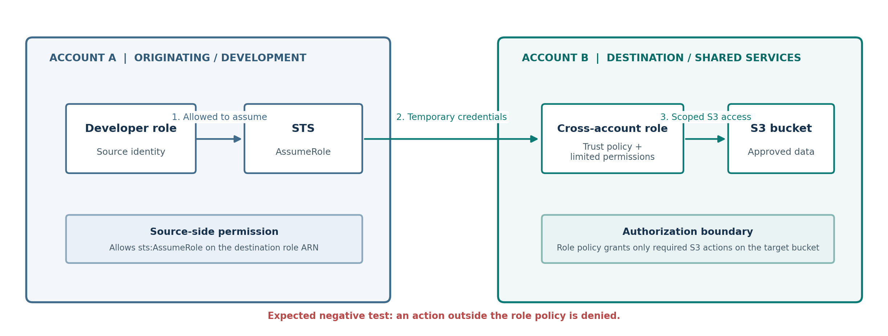

# Checkpoint 1: The Account Access Challenge

**Study first:** the study part for this checkpoint is [`m03-brief.md`](m03-brief.md), in this folder.
**The situation:** A development team needs to reach a shared S3 bucket that belongs to another AWS account. The platform team doesn't want to create permanent users in that account.
**What this checks:** Your work from m02 and m03: trust policy versus permissions policy, role assumption, temporary credentials, scoped S3 access and AccessDenied troubleshooting.
**How long it takes:** About 4.75 hours (Day 4, after m03)
**How you'll work:** On your own
**Region:** Do everything here in Asia Pacific (Singapore), `ap-southeast-1`. Check the Region shown in the Console before you create anything.
**What you'll hand in:** A diagram, your trust and permissions policies, the source-side permission, proof of an allowed and a denied S3 action, and a short note about an error you hit.

---

## 1. The Challenge

You're the engineer asked to give a development identity access to a shared bucket in another account. That identity has to assume a role there, and the role may reach only the approved bucket and only the actions it needs. Then you prove it works, including that anything outside its scope is denied.

**Your task:** Set up a role in Account B that the approved identity in Account A can assume, then use it to reach only the approved bucket.

**When you're done, you'll be able to:**
- Configure a role trust relationship and the scoped permissions behind it.
- Assume the role and show one allowed and one denied S3 action.
- Explain which policy controls the trust relationship and which controls S3 permissions.

### Reference architecture

Figure 1. The source identity assumes a role in the destination account and receives temporary credentials for scoped S3 access.

---

## 2. Before You Start

Here is everything you need and a few boundaries, so you know where to focus.

| | What to know |
|---|---|
| **What you're given** | Sandbox 3 and Sandbox 4 as your two accounts. The recommended mapping is Sandbox 3 as Account A (the source) and Sandbox 4 as Account B (the destination), unless your instructor tells you the sandbox administrator set it up the other way round. A working identity or role in the source sandbox, plus the account IDs and role names for both accounts. A destination S3 bucket in Account B, or permission to create one. A starter trust-policy JSON and permissions-policy example with placeholders for the account ID, role ARN and bucket name. A note of which identity is allowed to assume the destination role |
| **How you'll get in** | The same sandbox access method as in m01, through the Console or the approved CLI profile |
| **Tools you'll use** | AWS Console, or CloudShell with the approved CLI profile |
| **Reference reading** | The primary implementation guide is the [Tutorial: Delegate access across AWS accounts using IAM roles](https://docs.aws.amazon.com/IAM/latest/UserGuide/tutorial_cross-account-with-roles.html). Optional pre-reading: [Cross-Account Access Explained](https://medium.com/@varun.thantry07/aws-cross-account-access-explained-securely-share-resources-across-aws-accounts-c254c93993c5) |
| **Limits to keep in mind** | Give access to the approved bucket and the required actions only. Don't create permanent users in the destination account, don't create or share long-term access keys, and never use root credentials |
| **Not part of this checkpoint** | Writing IAM JSON from scratch, and any bucket other than the approved one. You won't be graded on these |

This checkpoint is about understanding the relationship and configuring it correctly. You don't need to write complex IAM JSON from memory.

**Where you'll use what you've learned**

| Topic from class | Where it shows up here |
|---|---|
| Trust policy versus permissions policy (m02) | Step 2: you set up the trust relationship and the scoped permissions as two separate pieces |
| Temporary credentials and AWS STS (m02, m03) | Step 3: you work as the assumed role |
| Cross-account access architecture and role trust (m03) | Step 2: the role in Account B and the permission in Account A |
| Cross-account S3 access (m03) | Step 3: you list the bucket, upload or download, and see an action denied |
| AccessDenied troubleshooting (m03, m08) | Step 4: the first checks when a request is denied |

---

## 3. Your Steps

Work through these in order. Each step sets you up for the next one.

| Step | What to do | You'll know it worked when... |
|---|---|---|
| **1. Get ready** | Write down the source and destination account IDs and confirm which identity you're using in Account A | You have both account IDs and your active identity noted, and you know which sandbox is the source and which is the destination |
| **2. Build it** | In Account B, create or complete a destination IAM role that trusts the specific source identity or approved source role. Attach the starter permissions policy so it grants only the actions you need on the training S3 bucket (suggested scope: ListBucket on the bucket, and GetObject and PutObject on its objects). In Account A, add or complete the permission that lets your identity call `sts:AssumeRole` on the exact destination role ARN | Your trust policy, permissions policy and source-side permission are all complete, with the placeholders filled in |
| **3. Try it out** | Assume the role using the Console or the approved CLI profile and confirm that your active identity is now the assumed role. List the approved bucket and upload or download a sample file. Then try something outside the role's scope, such as deleting an object | Your active identity is the assumed role, the allowed S3 action works, and the out-of-scope action is denied |
| **4. Fix what's broken** | If assuming the role or an S3 request returns AccessDenied, work through the first checks: your active source identity, the source permission for the exact role ARN, the destination trust policy and the account IDs. For S3, also check the bucket name, the object key, your identity's permissions, the bucket policy and which account you're in. Make a note of one error you hit and how you fixed it | You know the cause, and your note records the error and the fix |
| **5. Wrap up** | Explain which policy controls the trust relationship and which controls the S3 permissions. Draw a simple account-and-role diagram, or annotate Figure 1. Collect your evidence without any credentials in it, and clean up the way your sandbox procedure says | Your explanation is written, your evidence is ready, and nothing is left behind that the cleanup procedure removes |

---

## 4. How You'll Know You're Done

Run through this checklist before you submit.

| ID | What to check | How to check it | What a pass looks like |
|---|---|---|---|
| DoD-cp1.1 | **Your trust relationship is correct** | Read your completed destination trust policy | Only the approved source identity or role is trusted |
| DoD-cp1.2 | **Your source permission is correct** | Read your source-side `sts:AssumeRole` permission | Your source identity can assume the exact destination role |
| DoD-cp1.3 | **Your permissions are scoped** | Read your destination permissions policy and your evidence of the allowed action | The assumed role can do the required S3 actions on the target bucket only |
| DoD-cp1.4 | **Access works and the negative test holds** | Look at your role-assumption, S3 and denied-action evidence | One allowed action succeeds and one out-of-scope action is denied |
| DoD-cp1.5 | **You can explain it** | Walk through your diagram out loud | You can describe the source identity, the trust policy, the role permissions and the temporary credentials |
| DoD-cp1.6 | **It's tidy and safe** | Check your evidence and both accounts | No long-term access keys were created or shared, no credentials appear in your evidence, and you cleaned up as the sandbox procedure says |

---

## 5. What to Hand In

- [ ] A simple account-and-role diagram, or your annotated copy of Figure 1
- [ ] Your completed destination trust policy and permissions policy
- [ ] The source-side `sts:AssumeRole` permission
- [ ] Evidence of a successful role assumption and an allowed S3 operation
- [ ] Evidence of one denied out-of-scope action
- [ ] A short note on one error you hit and how you fixed it

---

## 6. How It's Reviewed

Only the three checkpoints are graded, and each one is assessed on its own. There are no percentage weights. You'll get one of three results:

| Result | What it means |
|---|---|
| PASS | You met all the critical conditions, your solution works, and you can explain your main settings |
| RETRY REQUIRED | One or more critical conditions weren't met. You get focused feedback, a guided correction and a chance to show it again |
| NOT YET DEMONSTRATED | You haven't yet shown a working solution or the required evidence |

To pass, you need checks DoD-cp1.1 to DoD-cp1.5 all met, and no credentials anywhere in what you hand in (DoD-cp1.6).
