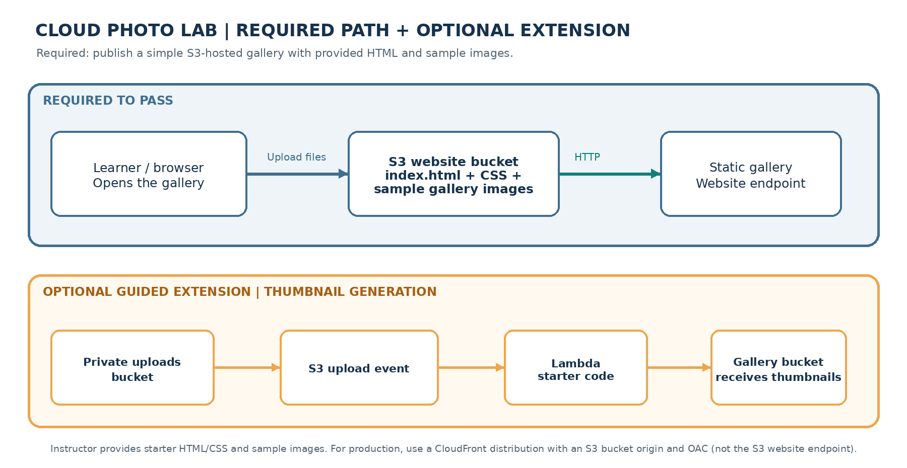

# Checkpoint 2: The Cloud Photo Gallery

**Study first:** the study part for this checkpoint is [`m05-brief.md`](m05-brief.md), in this folder.
**The situation:** A small team wants a simple webpage where colleagues can look through a collection of approved sample images.
**What this checks:** Your work from m04 and m05: buckets, objects, public versus private content and the S3 website endpoint.
**How long it takes:** About 4.75 hours (Day 6, after m05)
**How you'll work:** On your own
**Region:** Do everything here in Asia Pacific (Singapore), `ap-southeast-1`. Check the Region shown in the Console before you create anything.
**What you'll hand in:** Your working S3 website endpoint with the bucket name and Region, a screenshot or live demo of the gallery, and a short note on what's public and why.

---

## 1. The Challenge

You'll publish a static photo gallery with Amazon S3, using files your instructor gives you. The goal is to understand object storage and static website hosting first. Event-driven image processing comes in later, only as an optional extension.

**Your task:** Publish the provided gallery files as a static website from a dedicated S3 bucket, and open it in a browser.

**When you're done, you'll be able to:**
- Host a static website from an S3 bucket.
- Limit public read access to one training bucket, and only to the content that needs it.
- Explain why the direct S3 website endpoint isn't the preferred production design.

### Reference architecture

Figure 2. The S3-hosted gallery is the required activity. The Lambda thumbnail workflow is an optional guided extension.

---

## 2. Before You Start

Here is everything you need and a few boundaries, so you know where to focus.

| | What to know |
|---|---|
| **What you're given** | The starter files from your instructor: `index.html`, a CSS file and sample image assets. For the optional extension, working starter code and its image-processing package |
| **How you'll get in** | The sandbox account and sign-in method from m01 |
| **Tools you'll use** | AWS Console and a web browser |
| **Reference reading** | The [S3 static website tutorial](https://docs.aws.amazon.com/AmazonS3/latest/userguide/HostingWebsiteOnS3Setup.html) for the gallery. For the optional extension, the [Lambda S3 thumbnail tutorial](https://docs.aws.amazon.com/lambda/latest/dg/with-s3-tutorial.html) |
| **Limits to keep in mind** | Direct S3 website hosting needs public access to the website content and supports HTTP only, so keep this in a dedicated training bucket that holds sample assets only. Public access should allow `s3:GetObject` for the website content and nothing else: no public uploads, no public deletion. Don't upload any confidential or personal information, and never relax the protections on any other bucket |
| **Not part of this checkpoint** | The Lambda thumbnail extension (optional, not graded, and packaging the code is never a pass requirement) and the production design with CloudFront. You won't be graded on these |

**Where you'll use what you've learned**

| Topic from class | Where it shows up here |
|---|---|
| Buckets, objects and keys (m04) | Steps 1 and 2: a dedicated bucket and your uploaded gallery files |
| Block Public Access and bucket policies (m04) | Step 2: public read access limited to this training bucket |
| Static website hosting and the website endpoint (m04, m05) | Steps 2 and 3: you turn hosting on and open the endpoint |
| Public versus private content (m05) | Step 5: you explain what's public and why |
| CloudFront with Origin Access Control (m04) | Step 5: the production alternative, which you explain and don't build |
| Lambda, event triggers and CloudWatch Logs (m05, m08) | The optional extension only |

---

## 3. Your Steps

Work through these in order. Each step sets you up for the next one.

| Step | What to do | You'll know it worked when... |
|---|---|---|
| **1. Get ready** | Create a dedicated S3 bucket for the static gallery, with a unique name in the Singapore Region. Get the starter files from your instructor: `index.html`, the CSS and the sample image assets | Your bucket exists in the Singapore Region and the starter files are ready to upload |
| **2. Build it** | Upload the website files and the image assets to your bucket. Turn on static website hosting and set the index document. Set up the public read access this training bucket needs, following the AWS tutorial: allow only `s3:GetObject` for the website content, with no public uploads or deletion | Your files are in the bucket, hosting is on with the index document set, and public access is limited to this bucket and to reading |
| **3. Try it out** | Open the website endpoint in a browser and check that the gallery loads and the sample images show | The gallery loads and the sample images display |
| **4. Fix what's broken** | If the site shows AccessDenied or 403, check the website endpoint, the index document, the bucket policy, the Block Public Access settings and the object permissions, using only your dedicated training bucket. If the site doesn't load, check that static website hosting is on, the endpoint is correct and the index file is where it should be. Make a note of what you found | The gallery loads and you know the cause. If it worked first time, your notes say so |
| **5. Wrap up** | Explain why the direct S3 website endpoint uses HTTP and why it isn't the preferred production design. Write down which content is public and why your bucket holds only non-sensitive training assets. Record the bucket name and Region. Follow your instructor's cleanup instruction (a bucket has to be emptied before it can be deleted) | Your explanation is written, the bucket name and Region are recorded, and nothing is left behind that the cleanup instruction removes |

**Finished early? (Optional)** Try the guided extension that generates thumbnails with Lambda. Your instructor provides working starter code and the image-processing package, so you don't need to write any Python. It's never needed to pass.

| Step | What you do |
|---|---|
| 1 | Create a private S3 uploads bucket for the original images. |
| 2 | Configure an S3 ObjectCreated event to invoke the prepared Lambda function. |
| 3 | Use a Lambda execution role with only the read, write and logging permissions it needs. |
| 4 | Write the generated thumbnails to your gallery bucket. |
| 5 | Review the Lambda run in CloudWatch Logs. |
| Note | Keep the input and output buckets separate, so you avoid recursive S3-triggered invocations. |

---

## 4. How You'll Know You're Done

Run through this checklist before you submit.

| ID | What to check | How to check it | What a pass looks like |
|---|---|---|---|
| DoD-cp2.1 | **Your website files are in place** | Look at the contents of your gallery bucket | The index file, the styles and the image assets are in the correct bucket |
| DoD-cp2.2 | **Website hosting is set up** | Open the S3 website endpoint | It loads the index document |
| DoD-cp2.3 | **Your gallery works** | Open it in a browser | The sample images show correctly |
| DoD-cp2.4 | **You can explain the security side** | Explain it out loud | You can explain public access, why the content is non-sensitive sample content, and the production alternative |
| DoD-cp2.5 | **It's tidy and safe** | Read your bucket policy and bucket contents, and check your account | Public read is limited to this training bucket and to `s3:GetObject`, nothing public can be uploaded or deleted, there's no confidential or personal information, and you cleaned up as your instructor said |

---

## 5. What to Hand In

- [ ] Your working S3 website endpoint, with the bucket name and Region recorded
- [ ] A screenshot or live demo of your gallery
- [ ] A short note on which content is public, why your bucket holds only non-sensitive training assets, and why this endpoint isn't the preferred production design

---

## 6. How It's Reviewed

Only the three checkpoints are graded, and each one is assessed on its own. There are no percentage weights. You'll get one of three results:

| Result | What it means |
|---|---|
| PASS | You met all the critical conditions, your solution works, and you can explain your main settings |
| RETRY REQUIRED | One or more critical conditions weren't met. You get focused feedback, a guided correction and a chance to show it again |
| NOT YET DEMONSTRATED | You haven't yet shown a working solution or the required evidence |

To pass, you need checks DoD-cp2.1 to DoD-cp2.4 all met, with public access limited as described in DoD-cp2.5.
