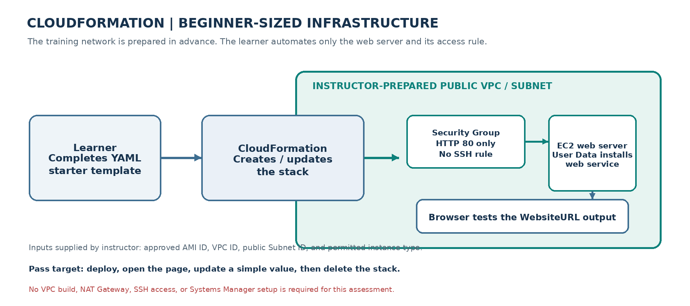

# Checkpoint 3: One-Click Infrastructure

**The situation:** A team needs a repeatable way to launch a basic web server. Instead of creating the server and its access rule by hand every time, you'll complete a CloudFormation template that creates both.
**What this checks:** Your work from m07 and m10: template structure, a Security Group, an EC2 instance with User Data, and the stack lifecycle of create, update and delete.
**How long it takes:** About 13.5 hours over two days (Day 9 build, Day 10 checking)
**How you'll work:** On your own, with instructor checkpoints on both days
**Region:** Do everything here in Asia Pacific (Singapore), `ap-southeast-1`. Check the Region shown in the Console before you create anything.
**What you'll hand in:** Your completed template, the stack name and status, the working website URL, proof of a Change Set update, proof of cleanup, and a short explanation.

---

## 1. The Challenge

You'll complete a CloudFormation template that creates an EC2 instance and its Security Group inside a network your instructor has already prepared. You don't build the network in this checkpoint.

**Your task:** Complete the starter template so one stack creates a web server and its access rule, then deploy it, update it and delete it.

**When you're done, you'll be able to:**
- Complete the parameters and resource definitions of a starter CloudFormation template.
- Deploy a stack, read its events and open the web page it serves.
- Update the stack after reviewing a Change Set, delete it and check that everything it created is gone.

### Reference architecture

Figure 3. CloudFormation automates the Security Group and the EC2 instance. The VPC and the public subnet are prepared in advance.

---

## 2. Before You Start

Here is everything you need and a few boundaries, so you know where to focus.

| | What to know |
|---|---|
| **What you're given** | A sandbox where you can create EC2 instances, Security Groups and CloudFormation stacks. A prepared public VPC and subnet with a route to an Internet Gateway and public IP assignment. An approved AMI ID for Singapore and an allowed small instance type. A starter CloudFormation YAML file with the basic structure and placeholders. A cleanup procedure, and a time limit for how long your instance may run |
| **How you'll get in** | The sandbox account and sign-in method from m01 |
| **Tools you'll use** | AWS Console or CloudShell, a text editor for YAML, and a web browser |
| **Reference reading** | [CloudFormation template anatomy](https://docs.aws.amazon.com/AWSCloudFormation/latest/UserGuide/template-anatomy.html), [EC2 CloudFormation examples](https://docs.aws.amazon.com/AWSCloudFormation/latest/UserGuide/quickref-ec2-instance-config.html) and [AWS::EC2::Instance reference](https://docs.aws.amazon.com/AWSCloudFormation/latest/TemplateReference/aws-resource-ec2-instance.html) |
| **Limits to keep in mind** | Inbound HTTP (TCP port 80) only, with no inbound SSH rule. Stick to the allowed small instance type, and don't leave your instance running past the time limit |
| **Not part of this checkpoint** | Building a VPC, a public and private subnet architecture, an Internet Gateway, a NAT Gateway, an IAM instance profile or Systems Manager access. Your instructor prepares these or they're introduced separately, and you won't be graded on them |

**How the two days run**

| Day | Your focus | Your instructor's checkpoint |
|---|---|---|
| Day 9: build and first deployment | Review the starter template, complete the parameters and resource definitions, validate the YAML, deploy your first stack and resolve any initial stack errors | Checks your template structure, the required resources, your stack events and the first deployment, and guides you without completing the template for you |
| Day 10: validation and final checking | Test the website, verify your access rules, make a small stack update through a Change Set, explain your template and delete the stack | Runs the technical walkthrough, checks each pass criterion, records PASS or RETRY and confirms your cleanup |

**Where you'll use what you've learned**

| Topic from class | Where it shows up here |
|---|---|
| Template anatomy: Parameters, Resources, Outputs (m10) | Steps 1 and 2: you complete the starter file section by section |
| Security Groups (m06, m07) | Step 2: HTTP in, no SSH |
| EC2 instances and User Data (m07) | Step 2: an instance that installs and starts a web server at first boot |
| Stack lifecycle and Stack Events (m10) | Steps 3 and 4: you deploy, read events, update and delete |
| Change Sets (m10) | Step 3: you review the proposed change before you run it |
| The prepared network (m06) | Step 5: you name the components your instructor prepared |

---

## 3. Your Steps

Work through these in order. Each step sets you up for the next one.

| Step | What to do | You'll know it worked when... |
|---|---|---|
| **1. Get ready** (Day 9) | Open the starter YAML file and find its Parameters, Resources and Outputs sections | You can point to all three sections |
| **2. Build it** (Day 9) | Complete the Parameters for the approved AMI ID, instance type, VPC ID and public Subnet ID, using the values your instructor gives you. Define a Security Group that allows inbound HTTP (TCP port 80) for the training page, with no inbound SSH rule. Define an EC2 instance that uses the supplied subnet and the Security Group your stack creates. Add a short User Data script that installs and starts the web server and writes a simple welcome page. Add Outputs for the public IP address and a website URL | Your template is complete: the parameters, the Security Group, the instance and the outputs are all there |
| **3. Try it out** (Day 9 deploy, Day 10 test and update) | Validate the template and deploy the stack. Review the stack events and wait for CREATE_COMPLETE. On Day 10, open the website URL and check that the welcome page loads. Make a small change, such as the page message or a tag, and update the stack, using a Change Set where available to look at the proposed change before you run it | The stack reaches CREATE_COMPLETE, the welcome page loads, and your update is applied after you reviewed the Change Set |
| **4. Fix what's broken** (as needed) | If the stack fails, open its Events tab, find the first resource failure and read the status reason, then check your parameter values and template syntax. If the page doesn't load, check the instance state and status checks, the public IP, the subnet's route to the Internet Gateway, the public IP assignment, the Security Group's HTTP rule and the User Data output. Make a note of what you found | The stack and the page work and you know the cause. If it worked first time, your notes say so |
| **5. Wrap up** (Day 10) | In the technical walkthrough, explain your template, its inputs, the resources it created and the network components your instructor prepared. Delete the stack and check that the EC2 instance and the Security Group it created are gone | You've given your explanation, and the instance and the Security Group your stack created are removed |

---

## 4. How You'll Know You're Done

Run through this checklist before you submit.

| ID | What to check | How to check it | What a pass looks like |
|---|---|---|---|
| DoD-cp3.1 | **Your template is valid** | Validate the template and read the stack status | The template validates and the stack reaches CREATE_COMPLETE |
| DoD-cp3.2 | **Your resources are defined in code** | Read your template and the stack's resources | The stack creates the Security Group and the EC2 instance |
| DoD-cp3.3 | **Your web server works** | Read your User Data and open the website URL | User Data installs and starts the web service, and the website URL loads |
| DoD-cp3.4 | **Access is safe and basic** | Read the Security Group rules in your template and in the Console | HTTP is enabled for the lab and no inbound SSH rule is created |
| DoD-cp3.5 | **You understand the stack lifecycle** | Look at your update and Change Set evidence and your deletion evidence | You updated and deleted the stack, and checked that the instance and the Security Group were removed |
| DoD-cp3.6 | **You can explain it** | Day 10 technical walkthrough | You can explain your template, its inputs, the resources it created and the network components prepared in advance |

---

## 5. What to Hand In

- [ ] Your completed CloudFormation YAML template
- [ ] The CloudFormation stack name and its successful deployment status
- [ ] The working website URL and browser evidence
- [ ] Evidence of a successful stack update and of the Change Set review
- [ ] Evidence that you deleted the stack and the resources it created were cleaned up
- [ ] A short explanation of what your template created and which network components were prepared in advance
- [ ] Notes on what went wrong and how you fixed it, if the stack or the page failed first time

---

## 6. How It's Reviewed

Only the three checkpoints are graded, and each one is assessed on its own. There are no percentage weights. You'll get one of three results:

| Result | What it means |
|---|---|
| PASS | You met all the critical conditions, your solution works, and you can explain your main settings |
| RETRY REQUIRED | One or more critical conditions weren't met. You get focused feedback, a guided correction and a chance to show it again |
| NOT YET DEMONSTRATED | You haven't yet shown a working solution or the required evidence |

To pass, you need checks DoD-cp3.1 to DoD-cp3.5 all met, with no inbound SSH rule (DoD-cp3.4).
